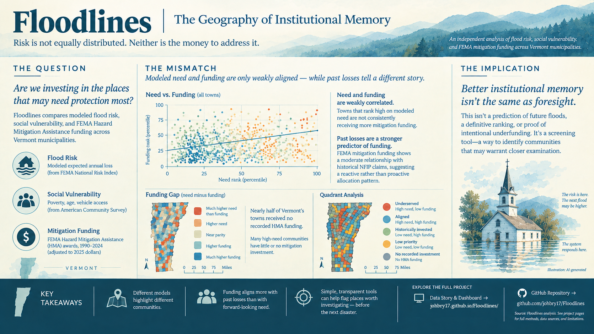
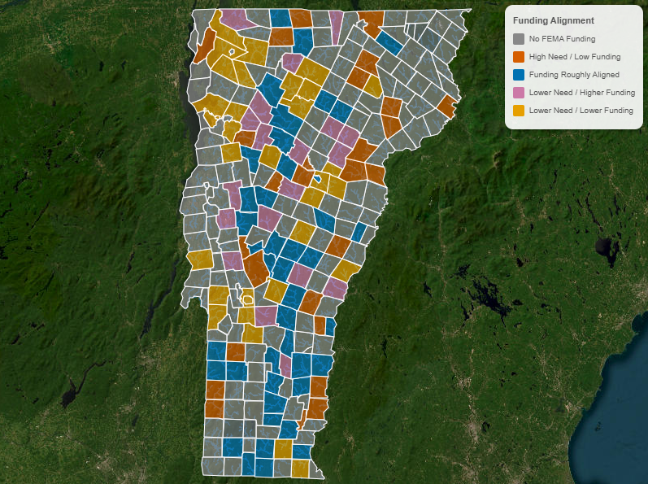
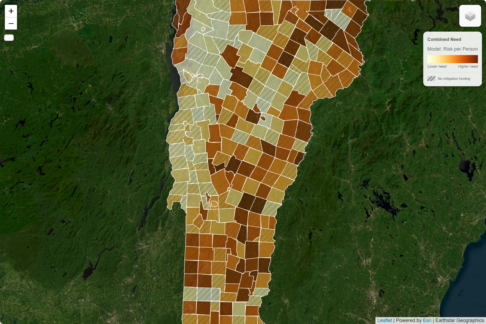
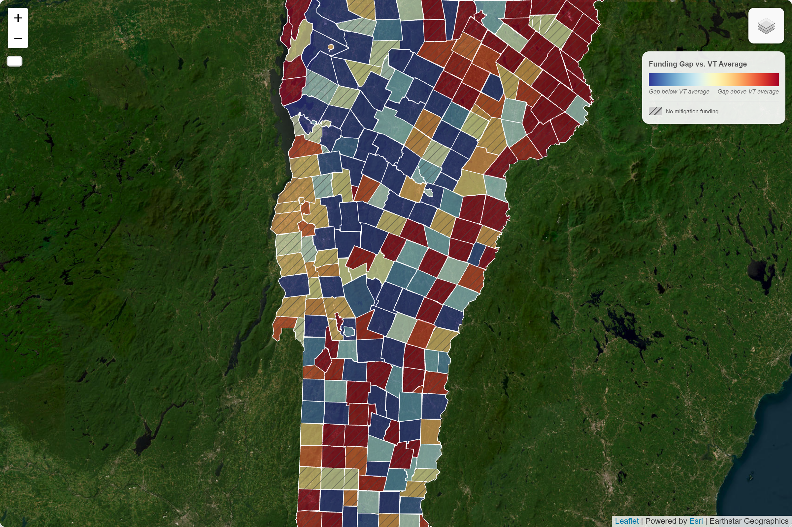
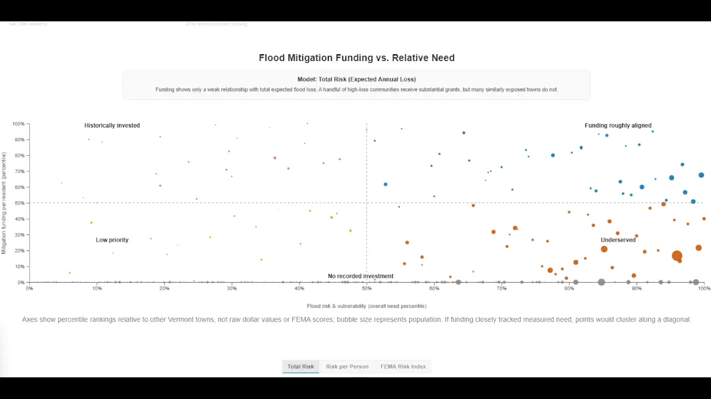
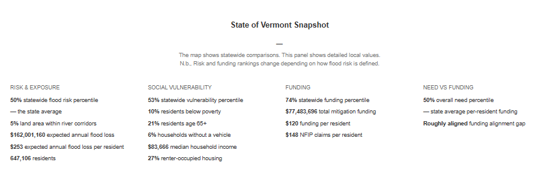
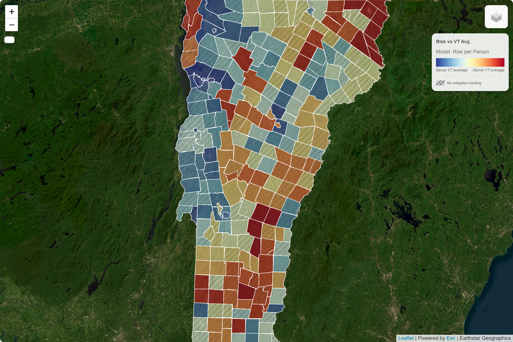
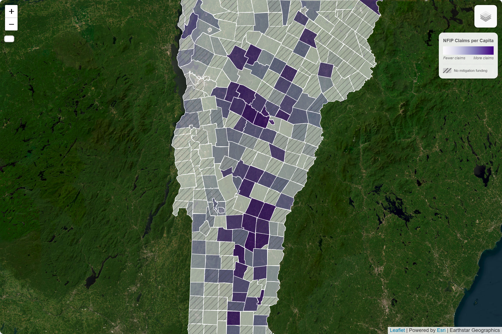
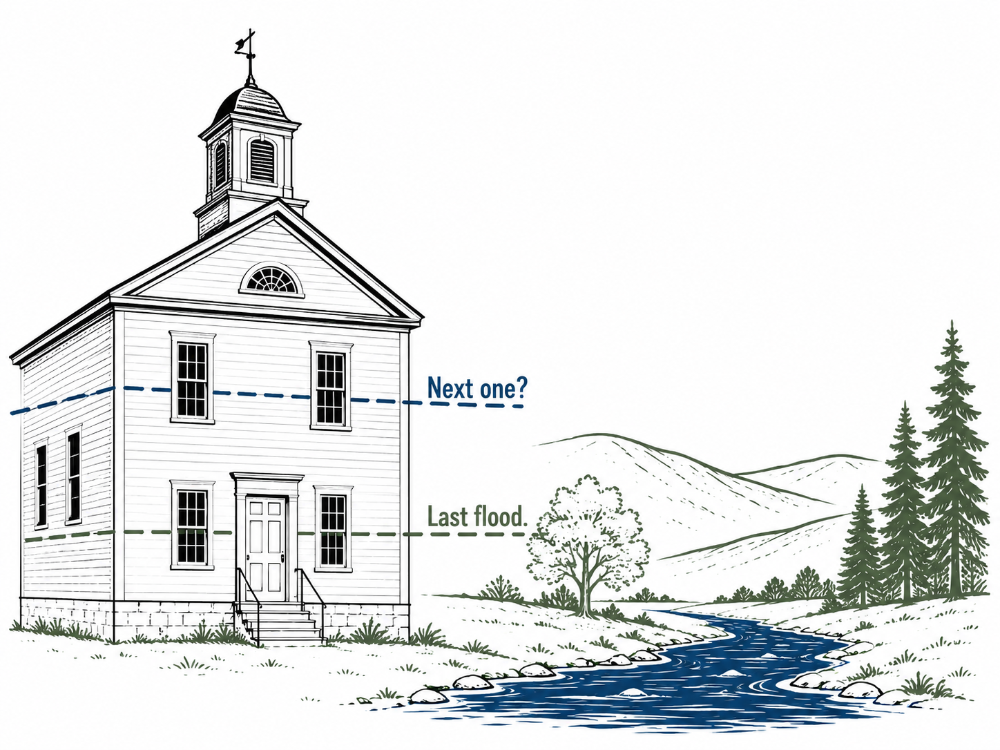
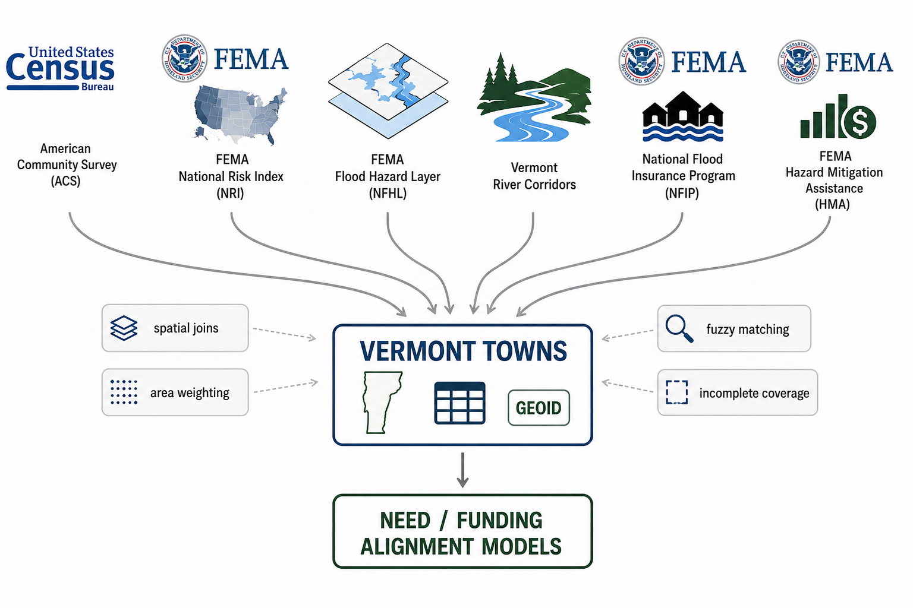

# Floodlines

<!--  -->

_Risk is not equally distributed. Neither is the money to address it._  
An independent analysis of flood risk, social vulnerability, and FEMA mitigation funding across Vermont municipalities.

🔗 [Data Story & Dashboard](https://johbry17.github.io/Floodlines/)  
📖 [Analysis Article](https://johbry17.github.io/Floodlines/article.html)  
🔬 [Technical Appendix](https://johbry17.github.io/Floodlines/appendix.html)  

## Table of Contents

- [Project Overview](#project-overview)
- [Key Findings](#key-findings)
- [Dashboard & Features](#dashboard--features)
- [Gallery](#gallery)
- [Data Sources & Preparation](#data-sources--preparation)
- [Index Construction & Methodology](#index-construction--methodology)
- [Limitations](#limitations)
- [Tools & Technologies](#tools--technologies)
- [Setup & Usage](#setup--usage)
- [Repository Structure](#repository-structure)
- [References](#references)
- [License](#license)
- [Acknowledgements](#acknowledgements)
- [Author](#author)

## Project Overview

**Floodlines** is an index-based spatial analysis of flood risk, social vulnerability, and FEMA mitigation funding across Vermont's 250+ towns. The central question: _does mitigation funding align with flood risk and community need?_

Vermont has experienced repeated, severe flood events, most notably Hurricane Irene (2011) and the historic flooding of 2023. Yet federal mitigation funding has not flowed evenly. Some high-risk, high-vulnerability towns have received little to nothing. Others have received substantial investment. This project builds a reproducible, methodologically transparent framework to measure that gap. More broadly, Floodlines explores the geography of institutional memory. Federal mitigation programs are designed around real constraints: disaster declarations, competitive grant processes, local administrative capacity, and documented losses. The result is not necessarily a system that ignores future risk, but one that often sees future risk through the lens of past experience.

Floodlines combines federal hazard models, flood insurance records, Census demographics, and mitigation funding data into a single framework for comparing where risk exists, where money has gone, and where the two diverge.

The analysis combines:

- **GIS preprocessing** of flood zone, river corridor, and town boundary data
- **ACS demographic data** for town-level social vulnerability (poverty, age, vehicle access, and more)
- **FEMA Hazard Mitigation Assistance (HMA)** funding records, inflation-adjusted to 2025 dollars
- **NFIP** insurance claims and policy data
- **FEMA National Risk Index (NRI)** expected annual loss and composite risk scores
- **Index construction** using rank-based normalization across multiple model specifications, with sensitivity analysis
- **An interactive web dashboard** visualizing risk, vulnerability, need, gap, and quadrant assignment for every Vermont town
- **A cinematic data story** guiding users through the dashboard, showing not only what the data reveals, but why the patterns matter

### The Project at a Glance

[](./resources/images/Floodlines_Infographic.png)

*An independent analysis of flood risk, social vulnerability, and FEMA mitigation funding across Vermont municipalities. The project examines how recorded mitigation investment aligns with modeled community need and historical insured losses.* **Click the infographic to view the full-size image.**

## Key Findings

- **More than half of Vermont municipalities (~52%) received no FEMA Hazard Mitigation Assistance funding.**
- **Funding shows only weak alignment with forward-looking flood risk and vulnerability** (Spearman ~0.10–0.30 across model specifications).
- **Past insured losses are a far stronger predictor of funding** (Spearman ~0.55 for claims vs. funding), indicating a reactive rather than proactive allocation pattern.
- **The finding is robust to model choice:** sensitivity analysis across 20+ model specifications, two normalization methods, and variable permutations consistently yields the same result (need-index Spearman rank vs. z-score: 0.89–1.00).
- **Structural variables predict funding access better than they predict funding amounts:** logistic regression achieves moderate AUC (~0.70 for the primary model) for predicting whether a town receives any funding; OLS regression explains near-zero variance in funding amounts (R² ≈ 0).
- **Modeled need shows significant spatial clustering** (Moran's I), while funding does not exhibit the same geographic alignment.

## Dashboard & Features

**Interactive Dashboard:**

🔗 [https://johbry17.github.io/Floodlines/](https://johbry17.github.io/Floodlines/)

- **Narrative guided tour** that walks users through the dashboard's central question, introducing the maps, metrics, and findings in context
- **Quadrant map** classifying each town as underserved, aligned, historically invested, low priority, or no recorded investment
- **Choropleth map** of all Vermont towns, switchable across six metrics: flood risk, social vulnerability, need index, mitigation funding, funding gap, and NFIP claims
- **Model switcher** (EAL, EAL per capita, FEMA NRI) to explore how different risk definitions affect town rankings
- **Scatter plot** of need vs. funding, updating dynamically with the active model
- **Town-level detail panel** with key statistics and percentile rankings
- **Rankings table** showing each town's percentile position across all key metrics
- Relative-to-state-average toggle, river corridor and population overlays, and responsive mobile layout

**Analysis Pipeline:**

- Reproducible ETL notebooks for all data sources (GIS, ACS, FEMA HMA, NFIP, NRI)
- Index construction and model evaluation across 20+ model specifications and two normalization methods
- Sensitivity analysis (LOVO, weight perturbation, normalization comparison)
- Quadrant and exclusion analysis
- Spatial autocorrelation (Moran's I)
- Exportable web data with raw scores, percentile ranks, and relative-to-mean values

## Gallery

  
_Vermont towns classified as underserved, historically invested, aligned, low priority, or no recorded investment_

  
_Measuring Need: A rank-based composite of flood exposure and social vulnerability_

  
_Towns where need substantially exceeds FEMA HMA investment, highlighting the most underserved communities_

  
_The loose cloud confirms weak alignment between structural need and federal mitigation dollars; the model switcher shows how different risk definitions shift individual towns' positions_

  
_Per-town statistics, percentile rankings, and quadrant classification for a selected community_

<!--   
_Risk map rescaled to show deviation from the Vermont statewide average rather than absolute percentile rank_ -->

  
_Reactive benchmark layer showing where insured losses occurred vs. where modeled risk is highest_

  
_A visual metaphor for the central question explored in Floodlines: when institutions measure risk through past disasters, future floods may arrive above the last high-water mark._
<!-- _A visual metaphor for reactive flood planning and the geography of institutional memory. Illustration: AI-generated._ -->

## Data Sources & Preparation

| Source | Purpose |
|--------|---------|
| FEMA National Risk Index (NRI) | Expected Annual Loss (EAL), composite risk, vulnerability, and resilience scores (census tract → town via area-weighted interpolation) |
| FEMA Hazard Mitigation Assistance (HMA) | Town-level mitigation funding, 1996–2024, inflation-adjusted to 2025 USD |
| National Flood Insurance Program (NFIP) | Claims and policy data, aggregated by town and time period |
| U.S. Census / ACS | 2020–2024 ACS 5-year estimates; demographic and socioeconomic indicators |
| FEMA National Flood Hazard Layer (NFHL) | High-risk flood zone boundaries |
| Vermont ANR River Corridors | State-defined river corridor polygons |
| Vermont / Census town boundaries | Base geography for all aggregation |

  
_Data sources and analytical workflow used in this study. Federal hazard, insurance, demographic, and mitigation datasets are integrated at the municipal level and transformed into comparative measures of need, funding, and funding alignment._

**Spatial standardization:** All datasets were projected to an equal-area coordinate system (EPSG:5070) for area calculations, then converted to WGS84 for web mapping. FEMA NRI data (census tract level) was spatially intersected with town boundaries and allocated using area-weighted proportions; sliver overlaps under 1% were removed and weights renormalized.

**Funding scope:** Only approved, flood-related HMA projects localizable to a specific Vermont town are included; county-wide, regional, and statewide projects (~37% of filtered HMA records) are excluded, as are planning and administrative costs. Dollar amounts reflect the federal share obligated (~75% of total project cost), adjusted using CPI-U (FRED).

**NFIP note:** Claims and policies were cleaned, inflation-adjusted, and aggregated by town and time period. Fewer than 2% of Vermont housing units carry NFIP coverage, so claims data systematically underrepresents flood exposure statewide.

## Index Construction & Methodology

### Need Index

The need index combines two equally weighted components:

- **Risk (50%):** Expected Annual Loss (EAL) from FEMA NRI. EAL was selected over simpler spatial exposure metrics (percent NFHL flood zone, river corridor coverage) because it captures both hazard intensity and asset exposure — rather than treating all land within a flood polygon as equally at risk.
- **Vulnerability (50%):** Poverty rate, percent elderly, and percent of households without vehicle access. This parsimonious set balances interpretability and signal strength. Expanded specifications (adding housing tenure, disability, mobile homes) raised normalization sensitivity (mean rank difference 19–21 vs. 13–15 for core models) without improving logit AUC, violating the parsimony criterion.

The gap index is defined as need minus scaled funding; positive values indicate towns that rank higher on modeled need than on funding received. A moderate positive gap-need correlation (~+0.32 to +0.49 across models) confirms the gap captures allocation mismatch rather than simply re-labeling need.

### Normalization

Rank-based (percentile) normalization was chosen over z-score standardization for four reasons: robustness to extreme outliers in Vermont flood data, bounded [0,1] output interpretable to general audiences, comparability across variables with incompatible units and distributions, and confirmation from sensitivity analysis that the substantive findings are stable across both methods (need-index Spearman z vs. rank: 0.89–1.00).

### Model Selection

Twenty-plus candidate specifications were evaluated across three dimensions — predictive performance (logit AUC), normalization stability (Spearman rank vs. z-score), and interpretability — and three were carried forward for the dashboard:

| Model | Role | Selection Rationale |
|-------|------|---------------------|
| `core_EAL_model` | Primary | Highest logit AUC (0.70) |
| `eal_per_capita_model` | Robustness check | Most normalization-stable (Spearman 0.97) |
| `fema_national_risk_index` | External benchmark | FEMA's own composite for independent comparison |

Claims-based models were excluded because their high need–funding correlation (~0.55) reflects the same reactive dynamic the project is measuring: when past claims drive the need score, the gap index adds no independent signal (gap-need correlation ~0.04). EAL-based models outperform simple spatial exposure metrics on both predictive performance and normalization stability.

### Sensitivity Analysis

- **Leave-One-Variable-Out (LOVO):** Testing how removing each variable affects town rankings and underfunded identification. Key result: the choice of risk variable (EAL vs. spatial exposure) is the most consequential model decision; weighting choices (70/30, 30/70) produce stable results.
- **Normalization comparison:** Need index Spearman rank vs. z-score 0.89–1.00 confirms substantive findings do not depend on normalization method.
- **Distribution stability:** Rankings are stable across model specifications, with modest variation only at the extremes.

### Spatial Analysis

Moran's I confirms significant spatial clustering of modeled need. Choropleth maps confirm geographic consistency of risk patterns. Funding does not exhibit corresponding spatial alignment.

### Interpretation

The analysis does not establish that FEMA has deliberately underfunded high-risk communities. Federal mitigation programs operate within structural constraints: competitive grant processes require disaster declarations, matching funds, and local administrative capacity. Towns with documented losses are better positioned to apply and receive funding. What the analysis reveals is a system that responds more strongly to past damage than to forward-looking indicators of risk and community need.

Correlations and spatial associations described here identify patterns in the data. They do not establish that any particular allocation decision was caused by any measured variable. Precise rankings of individual towns should be interpreted with caution: index values near the median are sensitive to small input changes, and the uncertainty inherent in area-weighted NRI data means town-level precision is lower than state-level patterns.

## Limitations

- **Incomplete NFHL coverage:** FEMA flood zone mapping is not uniform across Vermont. Towns with less mapping may have underestimated spatial exposure.
- **Low NFIP penetration:** Fewer than 2% of Vermont housing units carry NFIP policies. Claims data captures only the insured fraction of flood losses, systematically undercounting exposure in lower-coverage areas.
- **Town-level aggregation:** Municipal boundaries are the unit of analysis. Within-town variation in risk, vulnerability, and funding distribution is not captured.
- **Funding data scope:** Dollar amounts reflect approved federal obligations, not unmet demand, unsuccessful applications, or locally-funded mitigation. The absence of funding does not establish that a town has not sought it.
- **Area-weighted NRI interpolation:** Allocating census-tract NRI values to town boundaries using area weights introduces noise, particularly for towns spanning multiple tracts with heterogeneous risk profiles.
- **Descriptive, not causal:** The analysis describes funding allocation patterns. It does not establish the cause of any specific allocation decision.

## Tools & Technologies

**Frontend:** JavaScript, Leaflet.js, D3.js, HTML/CSS  
**Backend:** Python, Pandas, GeoPandas, NumPy, Jupyter Notebook  
**Spatial:** GeoPandas, Shapely, libpysal, ESDA (Moran's I)  
**Statistics:** scikit-learn, scipy, statsmodels  
**Data sources:** U.S. Census / ACS, OpenFEMA, FEMA NFHL, Vermont ANR, FRED CPI  
**Hosting:** GitHub Pages

## Setup & Usage

**Live dashboard:**  
🔗 [https://johbry17.github.io/Floodlines/](https://johbry17.github.io/Floodlines/)

**Run the analysis locally:**

1. Clone the repository
2. Install dependencies (Python 3.10+, standard geospatial stack):
   ```bash
   pip install pandas geopandas numpy matplotlib seaborn scikit-learn scipy statsmodels esda libpysal jupyterlab
   ```
3. Download large source datasets excluded from version control (see `data/README.md`).
4. Run notebooks in order:
   - `01_etl_gis.ipynb` — spatial preprocessing
   - `02_etl_acs.ipynb` through `05_etl_fema_nri.ipynb` — source ETL
   - `06_etl_river_corridors.ipynb` — river corridor web layer
   - `09_etl_final_merge.ipynb` — merge all sources
   - `10_eda_overview.ipynb` through `13_eda_hma_nfip.ipynb` — exploratory analysis
   - `20_analysis_build_index.ipynb` — index construction and model evaluation
   - `21_sensitivity_checks.ipynb` — LOVO and weight sensitivity
   - `22_quadrant_and_exclusion_analysis.ipynb` — quadrant assignment
   - `29_export_to_web.ipynb` — generate `town_stats.csv` and `town_boundaries.geojson`

## Repository Structure

```
Floodlines/
├── notebooks/           # Full analytical pipeline (ETL → EDA → modeling → export)
├── data/
│   ├── raw/             # Original source datasets (some excluded from Git; see data/README.md)
│   ├── cleaned/         # ETL outputs and merged analytical dataset
│   └── resources/       # CPI, FEMA project codes, ZIP crosswalk
├── docs/                # GitHub Pages site (dashboard, article)
│   └── static/          # CSS, JS, and data assets for the dashboard
├── resources/images/    # Figures and gallery images
├── scripts/             # Utility scripts (map export)
├── data_dictionary_backend.md   # Variable reference for the analytical pipeline
├── data_dictionary_frontend.md  # Variable reference for the web export layer
└── technical_summary.md         # Methodology appendix
```

## References

- [U.S. Census Bureau, 2025 TIGER/Line Shapefiles: Vermont County Subdivisions](https://www2.census.gov/geo/tiger/TIGER2025/COUSUB/tl_2025_50_cousub.zip)  
  Used for Vermont town (county subdivision) boundaries and spatial joins.

- [U.S. Census Bureau, 2025 TIGER/Line Shapefiles: Vermont Areawater (Chittenden County)](https://www2.census.gov/geo/tiger/TIGER2025/AREAWATER/tl_2025_50007_areawater.zip)
  Used for delineating water bodies (including Lake Champlain) in Chittenden County for spatial masking of flood zones.

- [National Flood Hazard Layer (NFHL) Database](https://hazards.fema.gov/femaportal/NFHL/searchResult/)  
  Used for FEMA flood zone boundaries and risk mapping.

- [State of Vermont Agency of Natural Resources: River Corridors Data](https://www.arcgis.com/home/item.html?id=51797aa9327343b9a04215e5e59e00c5)  
  Used for delineating river corridors and flood-prone areas.

- [U.S. Census: American Community Survey Data](https://data.census.gov/)  
  Used for town-level demographic, housing, and socioeconomic variables.

- [OpenFEMA Dataset: Hazard Mitigation Assistance Projects](https://www.fema.gov/openfema-data-page/hazard-mitigation-assistance-projects-v4)  
  Used for FEMA mitigation funding and project allocation by town.

- [FEMA Mitigation eGrants Guide to Eligible Activities and Codes](https://www.fema.gov/sites/default/files/2020-08/fema_mt-egrants-guide-to-eligible-activities-and-codes_job_aid_March_2018.pdf)  
  Used to classify FEMA project types.

- [Federal Reserve Economic Data (FRED): Consumer Price Index for All Urban Consumers (CPI-U), U.S. City Average](https://fred.stlouisfed.org/series/CPIAUCSL)  
  Used for inflation adjustment of funding and economic variables to constant dollars. Downloaded as CSV for annual CPI values.

- [OpenFEMA Dataset: NFIP Redacted Claims](https://www.fema.gov/openfema-data-page/fima-nfip-redacted-claims-v2)  
  Used for town-level flood insurance claims analysis.

- [OpenFEMA Dataset: NFIP Redacted Policies](https://www.fema.gov/openfema-data-page/fima-nfip-redacted-policies-v2)  
  Used for town-level flood insurance policy counts and penetration.

- [UnitedStatesZipCodes.org ZIP Code Database](https://www.unitedstateszipcodes.org/zip-code-database/)  
  Used to assign Vermont towns to policies with missing community names via ZIP code crosswalk.

- [FEMA National Risk Index (NRI) Data](https://www.fema.gov/about/openfema/data-sets/national-risk-index-data)  
  Used for town-level expected annual loss, social vulnerability, and community resilience scores as risk and vulnerability benchmarks.

## License

MIT License © 2026 Bryan Johns. See [LICENSE](LICENSE) for details.

## Acknowledgements

Thanks to the Vermont Agency of Natural Resources, FEMA, and the U.S. Census Bureau for making the underlying data publicly available. Thanks to the open-source geospatial community — GeoPandas, libpysal, Leaflet, D3, and OpenStreetMap — for the tools that made this analysis possible.

## Author

Bryan Johns, June 2026  
[bryan.johns@informedwanderer.com](mailto:bryan.johns@informedwanderer.com) | [LinkedIn](https://www.linkedin.com/in/b-johns/) | [GitHub](https://github.com/johbry17) | [Portfolio](https://informedwanderer.com)  
— Fluent in Data. Fluent in Human.
